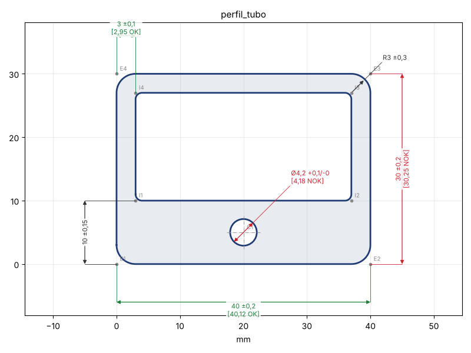

# Dibujador de Perfiles

App de escritorio para **Windows** que dibuja a partir de las medidas de una **consigna de calidad**:

- **Consigna de neumático** (Excel CONSIGNA): coloca cada producto desde el centro según su TRAZO.
- **Perfil genérico** (Excel/CSV con puntos y cotas): dibuja el perfil con cotas, tolerancias y
  estado **OK / NOK** de cada medida.

> 🔒 **Funciona sin conexión.** La app no se conecta a internet: tus consignas y medidas no salen
> de tu equipo.



## Cómo conseguir el .exe

**Opción A – descargarlo ya compilado (GitHub Actions)**
Cada vez que se sube código, GitHub compila el ejecutable en una máquina Windows.
Ve a la pestaña **Actions** del repositorio → la última ejecución de *Compilar .exe para Windows* →
descarga el artefacto **DibujadorPerfiles-windows** (zip con el `.exe`, los ejemplos y este README).
Descomprime y haz doble clic en `DibujadorPerfiles.exe`. No hace falta instalar nada.

**Opción B – compilarlo en tu PC**
Con Python 3.11+ instalado, doble clic en `build_exe.bat`. El ejecutable queda en `dist\`.

Para usarlo sin compilar: `pip install -r requirements.txt` y `python app.py`.

## Consigna de calidad de neumático (CONSIGNA / QXAX)

Abre directamente el Excel de la consigna (`.xlsx` / `.xlsm`): la app encuentra sola la tabla
`PROD. · APELACIÓN · ANC. · ESP. · ANG. · TRAZO · LONG. · PESO` y dibuja cada producto
**desde el 0 (centro del tambor)** según su **TRAZO**:

| TRAZO      | Cómo se coloca |
|------------|----------------|
| `C`        | Centrado en 0 (ANC/2 a cada lado). `C 100` → eje del producto a ±100 mm. |
| `IN 80`    | Borde **interior** a 80 mm del centro; el producto va de 80 a 80 + ANC. |
| `EX 190`   | Borde **exterior** a 190 mm del centro; el producto va de 190 − ANC a 190. |
| TT (aro)   | Sin ANC: se coloca en ±ENTRE-TRINGLES / 2. |

Cada producto se dibuja en los dos lados (AR a la izquierda, R a la derecha), con una flecha
desde el 0 hasta su trazo. Se marcan también las líneas de *entre aros* (ENTRE-TRINGLES) y *ancho total de carcasa* (HORS TOUT CARCASSE).

- **Sección:** Carcasa (GI → FE, hasta «FORME AU DIAMETRE»), Bandaje o Todo.
- **Vista:**
  - *Plano (semisección)* (por defecto): como el plano de la máquina. Va a escala real, con el 0 a
    la derecha y el radio del tambor (TAMBOUR / FORME AU DIAMETRE) en vertical. Los productos se
    apilan con su espesor en el orden de la consigna, el aro (TT) va en ±ET/2 y, si la consigna
    dice «RETOURNER PRODUIT NC», la NC (y lo que pasa del aro) se pliega alrededor del aro. Se
    muestra el retournement estimado junto a la COTE RETOURNEMENT de la consigna. Es un esquema:
    los productos se dibujan como trapecios con los bordes achaflanados, no con su perfil real.
  - **Aire entre productos** (en la vista Plano): cada producto se apoya sobre los anteriores con
    su **espesor (ESP)** y no entra en los rincones de los escalones que dejan los de debajo; el
    hueco que queda es aire (rayado rojo). Se ve sobre todo entre PS, BJ, PTR y FE. La pestaña
    *Aire entre productos* lista cada bolsa (entre qué productos y con qué ESP, dónde en mm desde el
    0, área en la sección y volumen por lado), y arriba sale el total. Dos ajustes, porque la
    consigna no da el perfil real de cada goma: *Chaflán bordes* (largo del chaflán × ESP) y
    *Rigidez goma* (radio con el que la goma puentea los escalones × ESP). **Simular ruletaje**
    aprieta los productos para ver cuánto aire quedaría tras pasar los apliques. El aire junto al
    aro se muestra aparte, como aproximado, porque el pliegue del retournement es un esquema.
  - **Aro, BT y burlete:** el aro (TT) se dibuja con su ESP y el **BT lo envuelve entero**: así
    se forma el burlete de la consigna (Ø Burlete = aro + 2 × BT, con su «Radio interior burlete»
    y centrado en entre aros / 2). El BT llega lleno hasta la HF («POSITION HAUT FALAISE/C»),
    donde la falaise hace de pared del burlete. Luego la NC se vuelve alrededor del burlete y el
    PTR envuelve todo; cada vuelta se calcula ángulo a ángulo con los espesores reales. Otras
    opciones: «BT vuelto con la NC» y «BT por encima del aro».
  - **Aro y vuelta de los productos:** el aro se dibuja con el **Ø Burlete** y el **Radio interior
    burlete** de la consigna. Solo se vuelve alrededor del aro el producto que indica la consigna
    («RETOURNER PRODUIT NC»), pegado al aro. Los demás que pasan del aro (BT, PTR…) lo envuelven por
    fuera con su espesor real y, si les sobra, vuelven por debajo. La app indica cuántos grados
    envuelve cada uno y si **solapa con la GI** (o cuántos mm le faltan).
  - **Optimizar posiciones (±2 mm):** busca cuánto mover cada producto sobre su TRAZO (como
    mucho X mm, en pasos de 0,5 mm) para dejar el mínimo aire entre productos. Muestra el TRAZO
    propuesto de cada producto y el aire antes/después, y se puede ver la propuesta en el dibujo
    (sale en rojo como «PROPUESTA, no es la consigna») o volver a la consigna original.
  - *Posiciones (TRAZO)*: una fila por producto, con la flecha desde el 0 hasta su trazo.
  - *Sección apilada*: los productos apilados por espesor (escala exagerada), a ambos lados.
- La tabla de abajo muestra el borde interior y exterior de cada producto en mm desde el 0.

## Formato de la consigna (perfil genérico)

Un Excel con dos hojas, **Perfil** y **Cotas** (mira `ejemplos/perfil_tubo.xlsx`, o usa el botón
*Guardar plantilla de ejemplo* dentro de la app).
En CSV: `nombre_perfil.csv` + `nombre_cotas.csv` en la misma carpeta (separador `;` o `,`,
decimales con coma o punto).

### Hoja «Perfil» — un punto por fila, en orden

| Columna   | Qué es |
|-----------|--------|
| Contorno  | Nombre del contorno (`Exterior`, `Interior`…). Un contorno dentro de otro se dibuja como hueco. |
| Punto     | Nombre del punto (`E1`, `A`…). Se usa en las cotas. |
| X, Y      | Coordenadas en mm. |
| Longitud, Angulo | Alternativa a X/Y: tramo desde el punto anterior (ángulo en grados, 0 = derecha, 90 = arriba). |
| Radio     | Redondeo de la esquina en ese punto (opcional). |
| Tipo      | `P` punto (por defecto) · `C` círculo/taladro (X, Y = centro, con `Diametro`). |
| Cerrado   | `NO` para un perfil abierto (por defecto se cierra). |

### Hoja «Cotas» — una cota de la consigna por fila

| Columna   | Qué es |
|-----------|--------|
| Nombre    | Descripción de la cota. |
| Tipo      | `H` horizontal · `V` vertical · `L` alineada · `D` diámetro · `R` radio. |
| Desde, Hasta | Puntos entre los que se mide (`D` y `R` solo usan *Desde*). |
| Nominal   | Valor nominal (si se deja vacío, se calcula del dibujo). |
| Tol+, Tol- | Tolerancias (o una única columna `Tol` para ±). |
| Medido    | Opcional: valor real medido → la app lo marca **OK** (verde) o **NOK** (rojo). |
| Offset    | Opcional: distancia de la línea de cota al perfil; negativo = al otro lado. |

Si las coordenadas del perfil no cumplen la cota nominal de la consigna, la cota sale en **ámbar**
y la app muestra un aviso.

## Exportar

PDF, PNG (300 ppp), SVG o **DXF** (abre en AutoCAD/LibreCAD con capas PERFIL, EJES y COTAS).

## Desarrollo

```
pip install -r requirements-build.txt
python -m pytest
```
