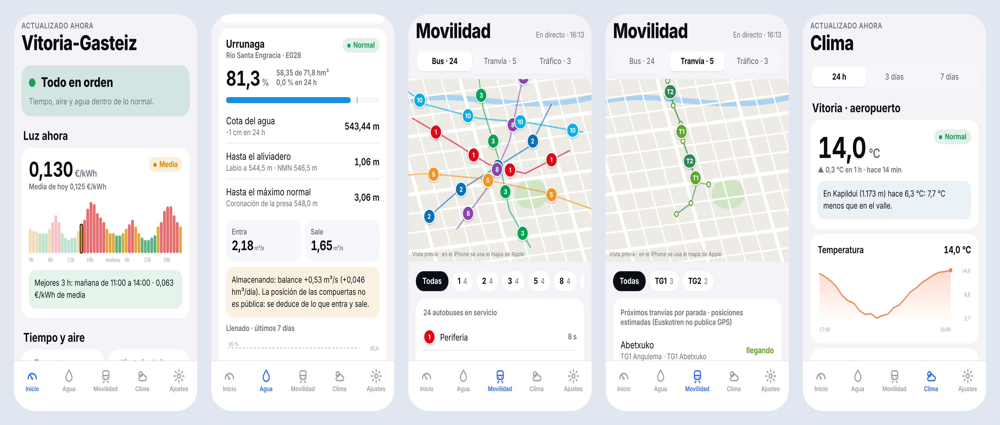
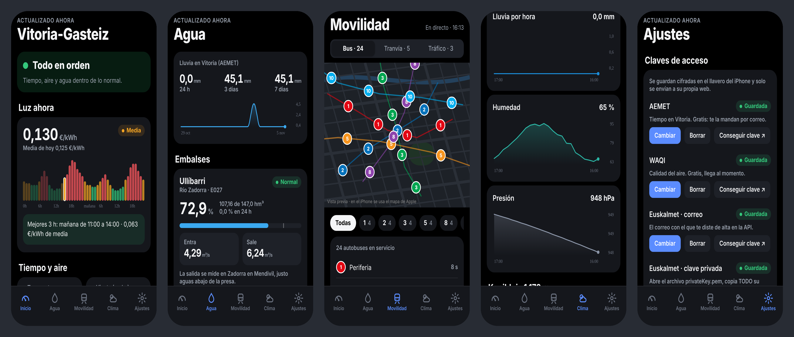

# Vitoria · app para iPhone

App nativa que funciona **sola en el móvil**: descarga los datos directamente de cada web pública,
los guarda en el iPhone y avisa con notificaciones. No necesita el ordenador encendido ni un servidor.




*Capturas con datos de ejemplo (`EXPO_PUBLIC_DEMO=1`). En el iPhone el mapa es el de Apple.*

| Pestaña | Qué enseña |
|---|---|
| **Inicio** | Estado general, precio de la luz ahora y mejores horas, tiempo, aire, embalses y tráfico |
| **Agua** | Ullíbarri y Urrunaga (llenado, cota frente al aliviadero y el NMN, entra/sale, si está desembalsando), Zadorra en Mendivil, lluvia y energía hidráulica |
| **Movilidad** | Mapa en directo: autobuses de Tuvisa (GPS cada 15 s), tranvía (se mueve entre paradas) y tráfico (incidencias y cámaras) |
| **Clima** | Vitoria (AEMET) y Kapildui (Euskalmet) con gráficas de 24 h / 3 días / 7 días, y calidad del aire |
| **Ajustes** | Claves, umbrales de alerta y estado de cada fuente |

## Instalarla en tu iPhone (gratis, sin Mac)

Se usa **Expo Go**, una app gratuita del App Store que abre apps hechas con Expo.
GitHub compila y publica la app; el iPhone la descarga y después funciona por su cuenta.

### Una sola vez (unos 10 minutos)

1. **Cuenta de Expo**: regístrate gratis en <https://expo.dev/signup>.
2. **Token de Expo**: en expo.dev → tu avatar → *Account settings* → *Access tokens* → *Create token*.
   Ponle de nombre `github` y copia el texto que sale (solo se ve una vez).
3. **Dárselo a GitHub**: en tu repositorio `asierenux/blank-app` → *Settings* → *Secrets and variables* →
   *Actions* → *New repository secret*. Nombre: `EXPO_TOKEN`. Valor: el token del paso 2.
4. **Publicar**: en el repositorio → pestaña *Actions* → *App móvil* → *Run workflow*.
   Tarda unos 3 minutos. Al terminar, el resumen muestra un enlace a expo.dev.
5. **En el iPhone**: instala **Expo Go** del App Store y entra con tu cuenta de Expo.
   Abre el enlace del paso 4 → la actualización más reciente → **Preview** → escanea el QR con la cámara.

Desde entonces la app aparece en Expo Go (pestaña *Home*, sección *Projects*). Cada vez que se suba un
cambio, GitHub publica la nueva versión y Expo Go la descarga sola.

### Las claves

Están en la pestaña **Ajustes**. Se guardan cifradas en el llavero del iPhone.

- **AEMET** y **WAQI**: copia y pega la misma clave que usas en el programa del ordenador.
- **Euskalmet**: tu correo y el contenido del archivo `privateKey.pem`. Para pasarlo al móvil,
  ábrelo en el PC con el Bloc de notas, cópialo y envíatelo (por ejemplo, en una nota o un correo a ti mismo).
  Pega el texto completo, incluidas las líneas `-----BEGIN…` y `-----END…`.

Sin claves ya funcionan: luz, embalses, ríos, energía, tráfico, autobuses y tranvía.

## Qué cambia respecto al programa del ordenador

- **Las actualizaciones solo ocurren con la app abierta** (al abrirla, al volver a ella y cada minuto).
  iOS no deja que una app esté consultando webs sin parar en segundo plano. Las alertas llegan cuando
  abres la app; para vigilancia 24 h sigue sirviendo el programa del PC con Telegram.
- El histórico (hasta un mes) se guarda solo en el iPhone.
- **Con icono propio en la pantalla de inicio** (sin pasar por Expo Go) hace falta la cuenta de
  desarrollador de Apple (99 $/año) y distribuirla por TestFlight con `eas build` + `eas submit`. No hace falta Mac.

## Pendiente de comprobar con datos reales

- **SAIH Ebro**: la ficha de cada estación rellena parte de los valores con JavaScript. Si en *Agua* sale
  "no se encontró ningún dato", hace falta la dirección interna de donde la web saca los valores.
- **Cámaras de tráfico**: la app las pide como un navegador. Si no se ven, la lista de cámaras trae otra dirección.
- **Euskalmet**: escrito según la documentación; en Ajustes › Fuentes se ve si responde.

## Para programadores

```bash
npm install --legacy-peer-deps
npm test               # 52 tests de la lógica (Node, sin móvil)
npx tsc --noEmit       # tipos
npx expo start         # vista previa con Expo Go en la misma wifi
EXPO_PUBLIC_DEMO=1 npx expo start --web   # demostración en el navegador con datos simulados
```

- `src/lib/`: lógica sin React (fuentes, histórico, niveles, alertas, motor). Es la traducción de `monitor-vitoria/`.
- `src/app/`: pantallas (Expo Router con pestañas nativas de iOS).
- `tests/datos/`: las mismas respuestas de prueba que usa el programa en Python.
