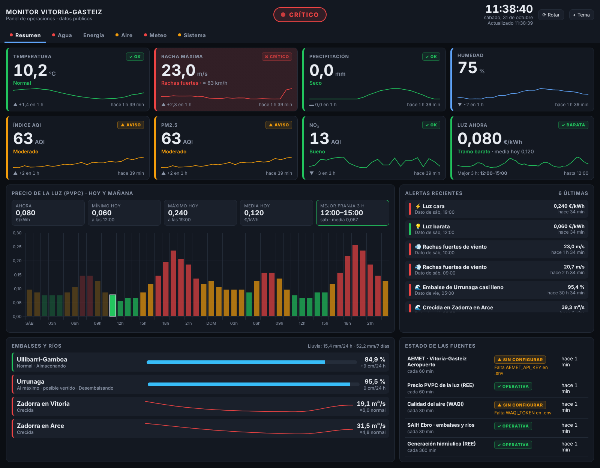
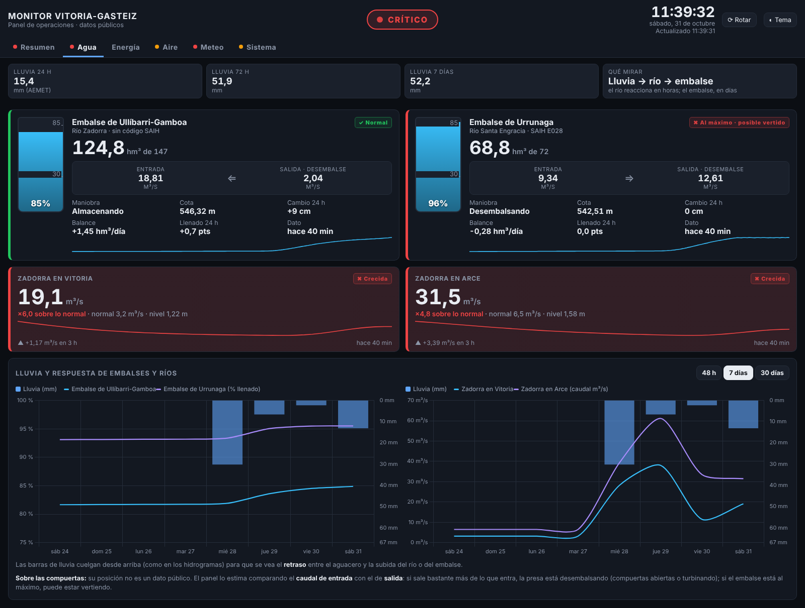

# monitor-vitoria

Recoge datos públicos de Vitoria-Gasteiz y los guarda en SQLite:

- 🌦️ **Meteorología**: AEMET OpenData, estación Vitoria-Gasteiz Aeropuerto (Foronda)
- 💡 **Precio de la luz (PVPC)**: Red Eléctrica (ESIOS, o REData sin token)
- 😷 **Calidad del aire**: WAQI (aqicn.org)
- 🌊 **Embalses y ríos**: SAIH Ebro (Ullíbarri-Gamboa, Urrunaga, río Zadorra)
- ⚡ **Generación hidráulica**: Red Eléctrica (País Vasco y península)

Además tiene un panel de operaciones web (FastAPI) y alertas por Telegram.




> ¿Sin claves todavía? `python -m monitor_vitoria demo` crea datos simulados en
> `datos/demo.db` y `python -m monitor_vitoria iniciar --demo` abre el panel con ellos.

---

## ⭐ Arrancarlo (la forma fácil)

1. Instala Python desde https://www.python.org/downloads/
   (en Windows, **marca la casilla «Add python.exe to PATH»**).
2. Entra en la carpeta `monitor-vitoria` y haz **doble clic** en:

   | | Datos reales | Datos de prueba (sin claves) |
   |---|---|---|
   | **Windows** | `iniciar.bat` | `demo.bat` |
   | **Mac** | `iniciar.command` | `demo.command` |
   | **Linux** | `./iniciar.sh` | `./iniciar.sh --demo` |

   La primera vez tarda 1-2 minutos (prepara Python y las librerías). Después arranca en segundos,
   se abre el navegador con el panel y la recogida de datos funciona sola mientras la ventana esté abierta.
   Si haces doble clic con el panel ya abierto, solo abre el navegador.
3. En el panel, pestaña **Sistema → Configuración**, pega tus claves y pulsa **Guardar y probar**.
   No hace falta tocar ningún archivo ni reiniciar.

> En Mac, la primera vez puede salir «no se puede abrir porque es de un desarrollador no identificado»:
> clic derecho sobre el archivo → **Abrir** → **Abrir**.

## Uso del panel: filtros

- **Periodo** (barra bajo las pestañas en Agua, Aire, Meteo y Explorar): 6 h, 24 h, 48 h, 7, 30 o 90 días,
  o **Fechas…** para elegir desde/hasta. **Resolución**: automática, cada dato, por horas o por días.
  El periodo elegido se recuerda la próxima vez.
- **Leyendas**: pulsa sobre una serie para ocultarla o mostrarla.
- **Explorar**: marca cualquier dato (temperatura, caudal del Zadorra, % de Urrunaga, precio de la luz…),
  compáralos en la misma gráfica, elige el cálculo por intervalo (media, máximo, mínimo, suma, último)
  y **descarga un CSV** que se abre con Excel.
- **Sistema**: configuración de claves, estado de cada fuente e historial de alertas con filtro por tipo y buscador.

## Guía paso a paso (para entender cómo funciona por dentro)

Si usas `iniciar.bat`/`iniciar.command` no necesitas nada de esto; es para aprender qué hace cada pieza.

### 1. Preparar Python y el entorno virtual

Necesitas Python 3.10 o superior (`python3 --version`).

Un **entorno virtual** (`.venv`) es una carpeta con un Python y unas librerías
solo para este proyecto. Así no mezclas versiones con otros proyectos.

```bash
cd monitor-vitoria
python3 -m venv .venv
source .venv/bin/activate          # Linux / macOS
# .venv\Scripts\activate           # Windows (PowerShell)
pip install -r requirements.txt
```

Sabrás que el entorno está activo porque la terminal empieza por `(.venv)`.

### 2. Configurar las claves

```bash
cp .env.example .env     # Windows: copy .env.example .env
```

Abre `.env` y rellena lo que tengas. **No hace falta tenerlo todo para empezar**:

| Clave | ¿Obligatoria? | Dónde se consigue |
|---|---|---|
| `AEMET_API_KEY` | para meteo | https://opendata.aemet.es/centrodedescargas/altaUsuario (llega por email) |
| `ESIOS_TOKEN` | **no** | email a consultasios@ree.es. Sin él se usa REData (pública) |
| `WAQI_TOKEN` | para calidad del aire | https://aqicn.org/data-platform/token/ |
| `TELEGRAM_*` | para alertas | ver paso 6 |

Comprueba qué ve el programa:

```bash
python -m monitor_vitoria estado
```

### 3. Primera recogida a mano

```bash
python -m monitor_vitoria recoger pvpc     # funciona sin ninguna clave
python -m monitor_vitoria recoger          # todas las fuentes
```

Qué pasa por dentro (abre los archivos mientras lo lees):

1. `__main__.py` lee la orden y llama a `servicio.ejecutar_recolector`.
2. `servicio.py` crea el recolector (`recolectores/pvpc.py`) y llama a `recoger()`.
3. El recolector hace la petición HTTP con `httpx` y convierte el JSON en
   objetos `Lectura` (`modelos.py`). Todas las fuentes hablan el mismo "idioma".
4. `db.guardar_lecturas` las inserta en SQLite. Si ya existían, se ignoran
   (por eso puedes repetir la orden sin duplicar datos).
5. Se apunta la ejecución en la tabla `ejecuciones` (bien o mal, y por qué).
6. `alertas.procesar` revisa las lecturas **nuevas** contra los umbrales.

Para mirar la base de datos puedes usar [DB Browser for SQLite](https://sqlitebrowser.org/)
o la terminal:

```bash
sqlite3 datos/monitor.db "SELECT * FROM lecturas ORDER BY momento DESC LIMIT 10;"
```

### 4. El planificador (recogida automática)

```bash
python -m monitor_vitoria planificador
```

Se queda funcionando y lanza cada recolector cada N minutos (`INTERVALO_*_MIN`
en `.env`). Hace una primera pasada nada más arrancar. Para pararlo: `Ctrl+C`.

### 5. El panel web

En **otra terminal** (con el entorno activado):

```bash
python -m monitor_vitoria web
```

Abre http://127.0.0.1:8000. Cómo leer el panel:

- **Arriba**: estado global (OPERATIVO / ATENCIÓN / CRÍTICO), reloj y hora de la última actualización.
- **Fichas**: cada indicador con su semáforo (✓ OK, ▲ AVISO, ✖ CRÍTICO), tendencia de la última hora,
  minigráfica de 24 h y antigüedad del dato. Si un dato es viejo sale "DATO ANTIGUO" y se atenúa.
- **Luz**: barras de hoy y mañana coloreadas barato/medio/caro *respecto a ese día*; la hora actual
  va recuadrada y las pasadas, atenuadas. "Mejor franja 3 h" = cuándo poner lavadora, coche, etc.
- **Alertas recientes** y **estado de las fuentes** (Operativa / Retrasada / Caída / Sin configurar).
- Se actualiza solo cada 60 s. Si se pierde la conexión con el servidor aparece una franja roja.
- **Pestañas**: Resumen, Agua, Energía, Aire, Meteo y Sistema. El punto de color de cada pestaña
  avisa si dentro hay algo en aviso o crítico. Se puede enlazar directamente: `http://…:8000/#agua`.
- **Agua**: depósito de cada embalse con su % de llenado, entrada → salida (m³/s), maniobra estimada,
  cambio de cota en 24 h; caudal de los ríos comparado con lo normal; y la gráfica **lluvia vs. respuesta**
  (48 h / 7 días / 30 días) para ver cómo suben ríos y embalses después de un día de mucha lluvia.
- **Modo pantalla de pared**: botón ⟳ o `http://…:8000/?rotar=20` (cambia de pestaña cada 20 s).

También tienes:

- http://127.0.0.1:8000/docs → documentación automática de la API (cortesía de FastAPI)
- http://127.0.0.1:8000/api/ultimas → los últimos valores en JSON

Mientras programas, `python -m monitor_vitoria web --reload` reinicia el
servidor solo cada vez que guardas un archivo.

> ¿Por qué dos procesos? El planificador **escribe** y el panel **lee**. Si
> uno falla, el otro sigue. SQLite en modo WAL permite leer mientras se escribe.

### 6. Alertas por Telegram

1. En Telegram, busca **@BotFather**, escribe `/newbot` y sigue los pasos.
   Te dará un token tipo `123456:ABC-...` → `TELEGRAM_BOT_TOKEN`.
2. Escríbele cualquier cosa a tu bot nuevo.
3. Abre en el navegador `https://api.telegram.org/bot<TU_TOKEN>/getUpdates`
   y busca `"chat":{"id":123456789` → ese número es `TELEGRAM_CHAT_ID`.
4. Prueba: `python -m monitor_vitoria probar-telegram`

Los umbrales están en `.env` (`ALERTA_*`). Deja uno vacío para desactivarlo.
Cada alerta se envía una sola vez (tabla `alertas_enviadas`), y las lecturas
de más de 3 horas no generan alerta (para no avisarte de lo de ayer al arrancar).

### 7. Embalses y ríos (SAIH Ebro)

La Confederación Hidrográfica del Ebro publica cada 15 minutos los datos de sus estaciones en
https://www.saihebro.com. **No tiene una API oficial**, así que el programa lee la página pública de
cada estación y busca los valores en el texto ("web scraping"). Pasos:

1. Busca la estación en saihebro.com (sección *Tiempo real*). El código aparece en la dirección,
   p. ej. `…/estacion-embalses-E028-urrunaga` → `E028`.
2. Compruébalo: `python -m monitor_vitoria probar-saih E028 --estacion urrunaga`
   Te dice si la página es de esa estación y qué valores ha encontrado.
3. Añádelo a `.env`: `SAIH_CODIGOS=urrunaga=E028,ullibarri=E0xx,zadorra_arce=A0xx`

Si un día la CHE cambia su web y deja de encontrar valores, `probar-saih` te enseña un trozo de la
página para ajustar los patrones de `recolectores/saih.py`.

**Lo que no es público:** la posición de las compuertas y la producción eléctrica de cada presa. El panel
lo aproxima: compara el caudal que entra en el embalse con el que sale (si sale mucho más, está
desembalsando) y muestra la generación hidráulica total del País Vasco que publica Red Eléctrica.

### 8. Tests

```bash
pytest
```

Los tests **no usan internet**: `tests/conftest.py` crea un cliente HTTP falso
que responde con los JSON de ejemplo de `tests/datos/`. Por eso cada recolector
separa `recoger()` (red) de `parsear()` (convertir JSON → lecturas).

---

## Dejarlo funcionando siempre

Depende de dónde lo vayas a ejecutar:

**Linux / Raspberry Pi (systemd)** — crea `/etc/systemd/system/monitor-vitoria.service`:

```ini
[Unit]
Description=monitor-vitoria planificador
After=network-online.target

[Service]
WorkingDirectory=/home/TU_USUARIO/monitor-vitoria
ExecStart=/home/TU_USUARIO/monitor-vitoria/.venv/bin/python -m monitor_vitoria planificador
Restart=on-failure
User=TU_USUARIO

[Install]
WantedBy=multi-user.target
```

Y otro igual con `web --host 0.0.0.0` para el panel. Luego:
`sudo systemctl enable --now monitor-vitoria`.

**macOS**: `launchd` (un `.plist` en `~/Library/LaunchAgents`).
**Windows**: Programador de tareas, acción `.venv\Scripts\python.exe -m monitor_vitoria planificador`.

---

## Estructura

Consulta [`CLAUDE.md`](CLAUDE.md) para la arquitectura completa, el esquema de
la base de datos y cómo añadir una fuente nueva.
